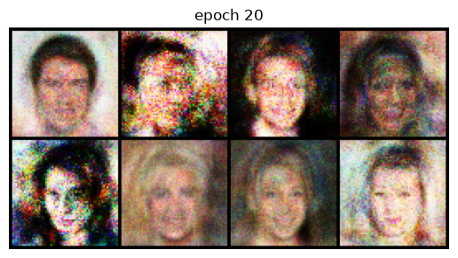

# Vanilla GAN from Scratch

A fully connected Generative Adversarial Network (GAN) built with PyTorch to generate small face images from the CelebA dataset. The project is implemented and trained in [`vanilla_gan.ipynb`](./vanilla_gan.ipynb).

## Sample output

Generated samples after epoch 20:



These are early-stage generated samples, so image quality and facial details are limited.

## How it works

- **Dataset:** CelebA images are center-cropped, resized to `64 × 64`, converted to tensors, and normalized to `[-1, 1]`.
- **Generator:** Maps a 100-dimensional noise vector through fully connected layers to an RGB image.
- **Discriminator:** Flattens an RGB image and predicts whether it is real or generated.
- **Training:** Uses `BCEWithLogitsLoss` and Adam optimizers. The notebook saves model and optimizer state after every completed epoch so training can be resumed.

## Setup

1. Install Python and the project dependencies:

   ```bash
   pip install torch torchvision pillow matplotlib numpy
   ```

   For GPU training, install the PyTorch build that matches your CUDA setup.

2. Obtain the CelebA image files according to the dataset's terms and place them in a directory. The directory should contain the image files directly (not just a nested folder).

3. Open `vanilla_gan.ipynb`. In the data setup cell, set `project_dir` to your project directory and make sure `root_dir_path` points to your image directory:

   ```python
   project_dir = "/path/to/Vanilla_GAN"
   root_dir_path = os.path.join(project_dir, "img_align_celeba")
   ```

   The notebook currently uses a Google Colab/Drive path, so update it when running elsewhere.

4. Run the notebook cells in order to load the data, create the models, and start training.

The notebook selects an available MPS or CUDA device, or falls back to CPU. Training processes the dataset repeatedly; interrupt the training cell when you want to stop. A checkpoint is saved after each completed epoch to `gan_checkpoint.pth` in `project_dir`.

To resume from an existing checkpoint, run:

```python
train(generator, discriminator, dataloader, resume=True)
```

The checkpoint file is intentionally not tracked by Git because it is large. Keep a copy locally if you need to resume training.

## What I learned

- How a generator and discriminator learn through competing objectives.
- Why image preprocessing and matching the real-image normalization to the generator's `tanh` output matter.
- How fixed noise helps compare generated samples across epochs.
- How to checkpoint model and optimizer state and resume training without starting over.
- How training device selection affects runtime and available hardware acceleration.
